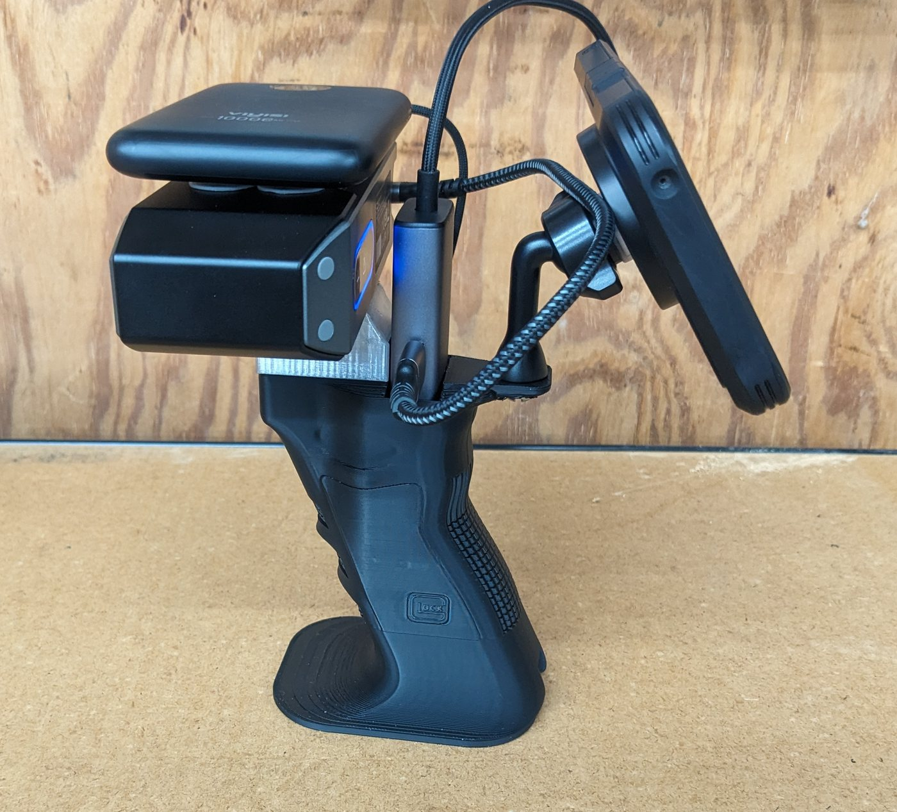
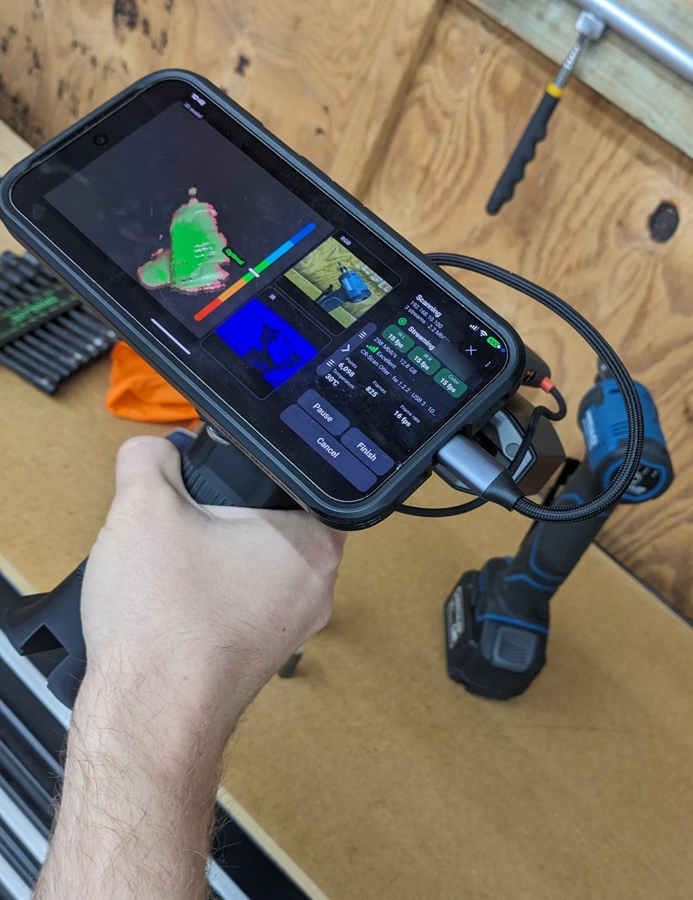
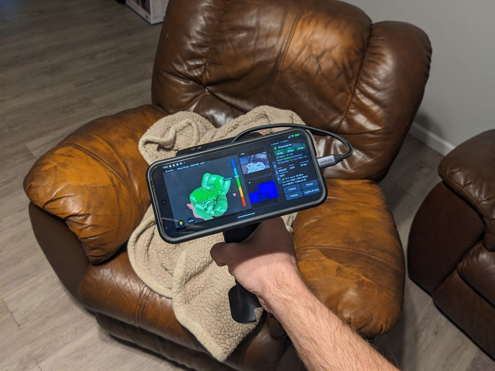

# Setups

Real rigs people scan with using CR-BYOB: the scanner, phone, hub and power, how they're held together, and
where to get the printed parts. Want to add yours? See [Share your setup](#share-your-setup).

- [Handheld grip: Otter, phone and USB-C hub](#handheld-grip-otter-phone-and-usb-c-hub) by [@NickLD](https://github.com/NickLD)

## Handheld grip: Otter, phone and USB-C hub

By [@NickLD](https://github.com/NickLD) · **3D model:
[Creality Otter 3D Scanner Phone & USB Hub mount Grip](https://www.printables.com/model/1905900-creality-otter-3d-scanner-phone-usb-hub-mount-grip)**
on Printables (CC BY-NC)

  &nbsp;&nbsp;
  
   
  Left: the rig from the side. Right: scanning a die grinder in a detached workshop, a separate building
  from the scanning PC, at the full 15 fps on all three streams.

  
   
  Scanning an armchair over home Wi-Fi 7 with the frame-rate override on Max: all three streams at about
  30 fps.

A one-handed grip that holds the scanner, the phone, a USB-C hub and a power bank. The scanner sits on a
dovetail mount on top. The handle has a cut-out in the bottom that the USB-C hub fits into, and the phone
clips on with a magnetic mount. It's made for the Otter and works with other scanners too.

**Printed parts** (both on the Printables page):

| File | What it is |
|---|---|
| `ScanHandleWithUsbHubCutout.stl` | The handle, with the cut-out for the hub |
| `DovetailScannerMount.stl` | The dovetail mount the scanner screws onto |

**Hardware:**

- 1/4-20 screws for the dovetail mount and the phone mount
- An M3 screw (about) to lock the dovetail in place

**Parts it's drawn around:**

| Part | Used |
|---|---|
| USB-C hub | [UGREEN Revodok 6-in-1 USB-C hub with Gigabit Ethernet](https://www.amazon.com/dp/B0BW2TLQ8S) |
| Phone mount | [Romuto magnetic phone tripod mount for MagSafe, 1/4" screw](https://www.amazon.com/dp/B0H4ZCDTWF) |
| Power bank | [VIYISI ultra-slim 10000 mAh portable charger with built-in USB-C cable](https://www.amazon.com/dp/B0G633FNQM) |

The Revodok's Gigabit port means the same rig works on [Ethernet](../README.md#choosing-a-connection) when
you're near the router, and its USB-C power input keeps the phone and scanner on the power bank rather than
the phone's battery. The Romuto mount is magnetic, so the phone needs MagSafe or Qi2 magnets, or a magnetic
case or ring.

## Share your setup

Built a rig, printed someone's mount, or found a hub that works well? Add it here:

- **Pull request:** add a section to this page with photos in `docs/photos/` (please strip location
  metadata from phone photos first), the parts you used, and a link to the model if you printed one.
- **Or open an [issue](https://github.com/NickLD/CR-BYOB/issues/new)** with the photos and links, and it'll
  be added for you, credited to your GitHub username.

Say which scanner and phone it's for and which connection you use with it.
