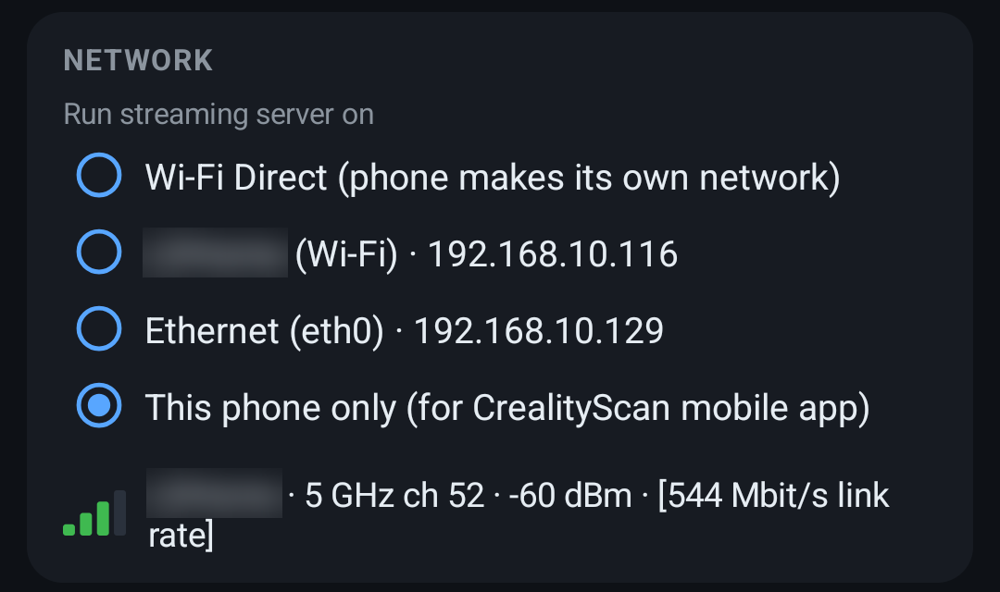
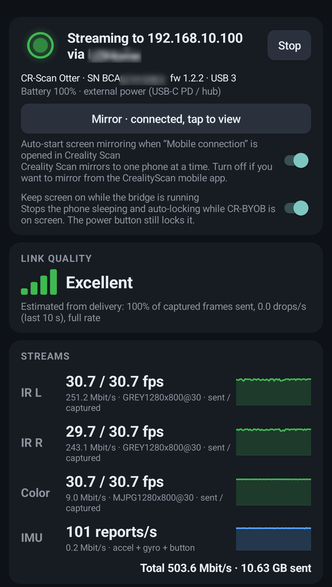
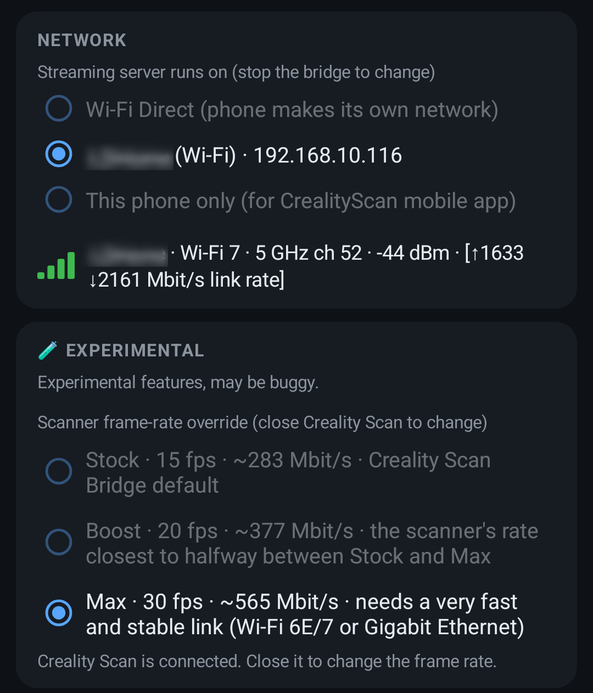
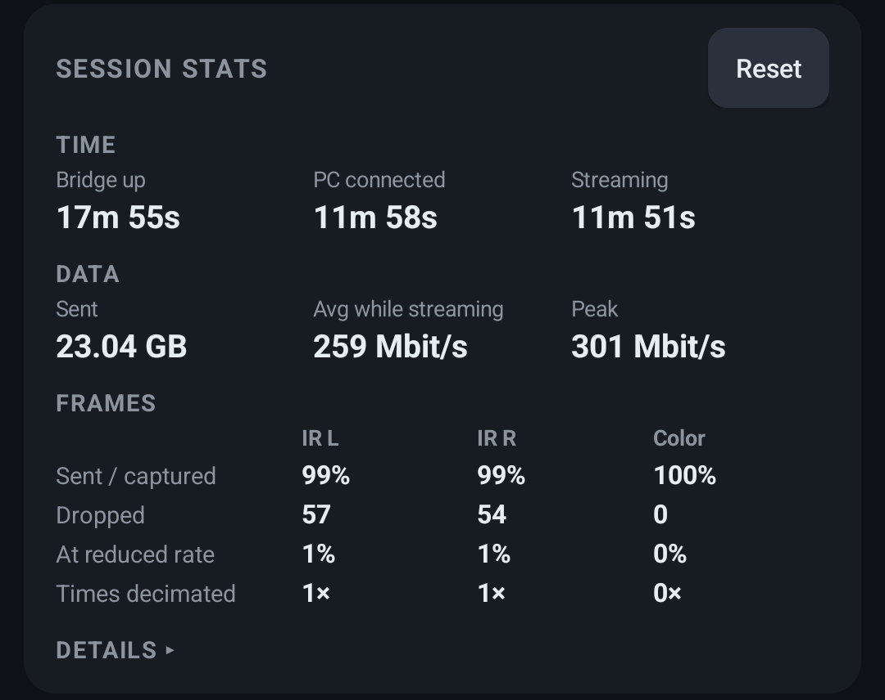
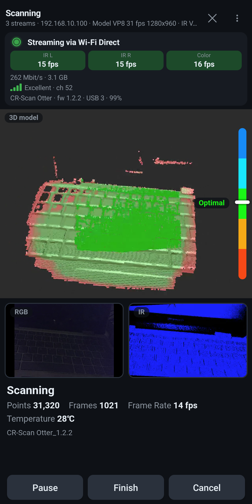
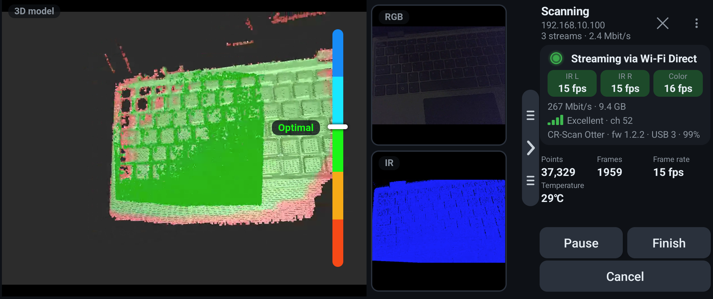
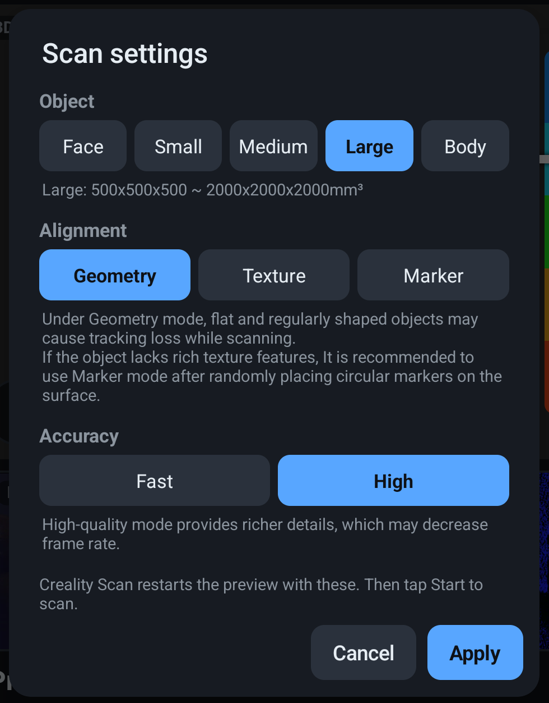

# Using the app

## What you need

- An Android 8+ phone with USB host (OTG) support and a **USB 3** port (required: the scanner's streams need
  more bandwidth than USB 2 provides).
- A USB 3 hub with power passthrough, so the scanner and phone don't run on the phone's battery. Without it
  the scanner can brown out mid-scan; the dashboard shows a red warning when the phone is on battery.
- For scanning from a PC: Creality Scan on the PC and a fast link between them (below). For scanning on the
  phone: the CrealityScan app on the same phone.

**The link.** With a CR-Scan Otter at full rate the bridge sends about 265 Mbit/s (two IR streams and color).
Other scanners differ, and higher-resolution ones need more. So:

- **Ethernet is the most reliable.** Many powered USB-C hubs also have an Ethernet port: one hub then gives the
  scanner its USB 3 port, keeps the phone charged and adds a wired link. It must be **Gigabit** (100 Mbit
  Ethernet can't carry the streams). Cable it to the router or switch your PC is on; thin, flat Ethernet cables
  are cheap and easy to route. Android sets up USB Ethernet by DHCP, so a cable straight to the PC (no router)
  won't give the phone an address.
- **Wi-Fi Direct** needs a phone and a PC with Wi-Fi 5 (802.11ac) or newer on 5 GHz; Wi-Fi 6 or newer is better.
- **Home Wi-Fi** needs a Wi-Fi 5 or newer router on 5 GHz with a strong signal at the phone. On 2.4 GHz expect
  about 6 fps instead of 15.

## First start

1. Install the APK from [Releases](https://github.com/NickLD/CR-BYOB/releases) and open **CR-BYOB**.
2. Allow what it asks for. Each permission is explained before Android's prompt:
   - **Camera** (required): Android only lets apps with it open USB cameras, and the scanner is one.
     CR-BYOB never uses the phone's own cameras.
   - **Notifications**: the running bridge shows a status notification with a Stop button.
   - **Location** (optional): Android hides the connected Wi-Fi's name behind it. It's used only to show
     the network name and to warn about weak or 2.4 GHz Wi-Fi.
   - **Nearby devices**: asked when you choose Wi-Fi Direct.
3. Plug the scanner in. Android asks whether CR-BYOB may open it; tick "always" and accept.
4. Choose a network (below) and tap **Start**.

## Choosing a network



*Run streaming server on* decides where the bridge can be found. The choice is fixed while the bridge runs;
stop it to change.

| Choice | Use it for |
|---|---|
| **Wi-Fi Direct** | The phone makes its own network, like the official Scan Bridge. Join it from the PC's Wi-Fi menu with the name and password shown, then start Creality Scan. |
| **Your Wi-Fi** | Phone and PC on the same home network. Needs a strong 5 GHz connection for the full frame rate. |
| **Ethernet** | Shown when a USB Ethernet adapter (or a hub's Ethernet port) is connected. The most reliable choice: no radio interference, full rate. Use Gigabit. |
| **This phone only (for CrealityScan mobile app)** | Scan on the phone itself with Creality's CrealityScan app, no PC. Nothing on the network can find or reach the bridge, and Wi-Fi speed doesn't matter. |

The bridge answers on exactly one network at a time: a PC that saw it on two would hang at Preview.

> [!NOTE]
> **The Wi-Fi Direct network won't appear in Creality Scan's Wi-Fi list.** Join it on the PC the way you join
> any Wi-Fi network: on Windows, the Wi-Fi icon in the taskbar, then the name and password the app shows. Once
> the PC is on it, the bridge shows up in Creality Scan by itself, as it would on your home network.
> [Why it's not in the list](#wi-fi-direct-not-in-creality-scan).

**Wi-Fi Direct details.** The network name is `DIRECT-SB-CRBYOB-` plus 4 characters unique to the phone, and the
password is shown below it (both copyable). *Edit Wi-Fi Direct settings* (while stopped) changes the part after
`DIRECT-SB-` and the password (8–63 characters). If the phone also stays on another Wi-Fi network, the two share
the phone's radio; the dashboard warns and offers to disconnect it. To join from Windows without the Wi-Fi
menu, use the profile template [`android/CRBYOB/DIRECT-SB-CRBYOB.xml`](../android/CRBYOB/DIRECT-SB-CRBYOB.xml)
(put your network name and password in first):

```bat
netsh wlan add profile filename=DIRECT-SB-CRBYOB.xml user=current
netsh wlan connect name="DIRECT-SB-CRBYOB-XXXX" ssid="DIRECT-SB-CRBYOB-XXXX" interface="Wi-Fi"
```

The group hands out a default gateway (192.168.49.1); if the PC also has Ethernet, make sure the Wi-Fi
route's metric is higher (`route print 0.0.0.0`).

## Scanner frame-rate override (experimental)

Behind a bridge, Creality Scan asks for less than the scanner can do: 15 fps for an Otter (30 on USB) and 10
for a Ferret. *Scanner frame-rate override* in the dashboard's Experimental card, below Network, raises that.
Nothing in Creality Scan is changed: the bridge advertises only the faster modes, and Creality Scan picks the
closest rate on offer.

| Choice | Otter | What it is |
|---|---|---|
| **Stock** | 15 fps, ~280 Mbit/s | Creality Scan Bridge default |
| **Boost** | 20 fps, ~380 Mbit/s | the scanner's rate closest to halfway between Stock and Max |
| **Max** | 30 fps, ~570 Mbit/s | the scanner's fastest mode; needs a very fast and stable link (Wi-Fi 6E/7 or Gigabit Ethernet) |

A CR-Scan Raptor uses different camera sizes per scan mode, so it gets separate rates for each. The card shows
blue-line's (Stock 30, Boost 40, Max 50 fps) and notes Infrared's below them (Stock 20, Boost 30). Infrared
has no Max: the scanner tops out at 30 fps in that mode, so on Max it runs at Boost.

Wired Gigabit is the safe choice for Max. A phone very close to a Wi-Fi 6E/7 access point can link faster
than Gigabit and has handled Max too (in one test it ran smoother than USB Ethernet); the viewer's stats panel
shows the Wi-Fi signal and link rate to judge it. The rates come from the attached scanner, so the card shows
them once the bridge is running. A scanner that Creality Scan already runs at its top rate shows only Stock.
Creality Scan reads the rate when it connects, so the choice is locked while it's connected: close Creality
Scan, change it, and open Creality Scan again (the bridge can keep running).

## The dashboard

<p>
  
  
</p>

From top to bottom:

- **Status**: a light (grey off, amber ready, blue PC connected, pulsing green streaming, red problem), a
  one-line status such as "Streaming to 192.168.49.224 via Wi-Fi Direct", and `? Troubleshooting / Help`, which opens these docs
  in the app at Troubleshooting. Warnings on the dashboard end in `How to fix ›`, which opens the matching
  question. Below it, the Start/Stop button (a spinner while the bridge starts or stops), then the scanner's
  model, serial, firmware and USB speed (shown before you tap Start too), then battery and power source. Start
  stays off while the scanner is on USB 2 (see [The app says the scanner is on USB 2?](#scanner-is-on-usb-2)).
- **Mirror** button and the auto-mirror and keep-screen-on switches (see Mirror viewer below).
- **Link quality** and **Streams** (while a PC or the phone app is connected): frames sent vs captured per
  stream, Mbit/s and a 60 s graph. Link quality is estimated from delivery, because Android reports no
  per-client signal for a Wi-Fi Direct group owner. When the link can't carry both IR streams, the bridge
  sends both at half rate in step (a "½ rate" badge) rather than dropping left and right frames unevenly.
- **Session stats**: time, data sent, average and peak bitrate, and per-stream delivery. *Details* has
  reliability counters and latency.
- **Network**: the choice above, plus the Wi-Fi line (network, Wi-Fi generation, band and channel, signal,
  and upload/download link rates) and speed warnings.
- **Experimental**: the scanner frame-rate override (above).
- **Events**: recent events in plain words, with the raw log below. *Export log* saves the whole log as a
  zip to attach to an issue, with serial numbers, Wi-Fi names, passwords and addresses removed.
- **Version** at the bottom: tap *What's new* (*What's new / Check for app updates* in GitHub builds); long-press to
  copy your app version, phone and Android version for a bug report. GitHub builds also have a Ko-fi button
  under it.



## Mirror viewer

The **Mirror** button shows Creality Scan's color, IR and 3D views on the phone, like Creality's own phone
app, with the scan controls (Start, Pause, Finish, and Delete once paused), a distance bar, and a stats panel
with the stream rates, Creality Scan's point and frame counts, and the bridge's Wi-Fi link (signal, link rate
and band).

<p>
  
  
</p>

- In Creality Scan on the PC, press **Mobile connection**. The PC only accepts a phone while that dialog is
  open. With *Auto-start screen mirroring* on (the default), the phone connects by itself and the button reads
  *Mirror · connected, tap to view*.
- Back returns to the dashboard and keeps the session; ✕ closes it. ⋮ offers a manual PC address and
  Reconnect, for networks that drop the PC's broadcast.
- Pinch zooms the 3D view on the PC; drag pans and double-tap resets. In landscape, the side column folds
  away with the edge tab.
- While the viewer is hidden, the phone asks the PC for a low-bandwidth mirror stream, so it doesn't compete
  with the scanner streams.
- **New scan**: when Creality Scan opens its New Scan page, the same settings open on the phone: object (face,
  small, medium, large, body), alignment (geometry, texture, markers), accuracy, and for some scanners
  projection, field of view and texture, plus the object color (standard, black, white, reflective) in Marker
  mode. Each choice shows Creality Scan's own description ("Medium: 250x250x250 ~ 500x500x500mm³"). It offers
  only what Creality Scan reports for the connected scanner and starts from the last settings used. **Create**
  makes the scan and starts the preview; then tap **Start**. **New scan…** reopens it, and during the preview
  **Settings…** changes the settings: Creality Scan restarts the preview with them. *Exclude Flat Base* stays
  on the PC: Creality Scan doesn't accept it from a phone.
- **Lights and exposure** (once a scan exists): 💡 on the 3D view switches the fill light, and **AUTO**
  switches IR exposure to manual (**MAN**), with a slider beside it. **Lighting…** also sets laser
  power and color exposure, each with its auto switch. Only the controls the scanner has are shown.
- Creality Scan's messages appear along the bottom of the 3D view ("Tracking lost…", "Preview…"), and its
  pop-ups ("Delete scan?", "Max frames reached", …) appear on the phone with the same buttons; your answer
  goes back to the PC. A few of its pop-ups exist only on the PC: while one is open Creality Scan ignores
  the phone and says "Someone is using Creality Scan on the PC". Answer it there.



**Mirror quality**: tap the *Mirror … fps ▾* pill on the main view.
- *Frame rate* (30, 20, 15 or 10 fps) and *3D view resolution* (Full, 75% or 50%). Creality Scan only takes the
  resolution when the mirror connects, so changing it reconnects the mirror for a second or two.
- *Adjust automatically* (on by default) treats both as a ceiling. When more than 5% of the last 20 s of mirror
  video froze, it lowers the resolution (Full → 75% → 50%) and, once that's at 50%, the frame rate
  (30 → 20 → 15 → 10): smooth motion matters more than detail for aiming the scanner. After 30 s of smooth
  video it raises the frame rate again, and after 2 smooth minutes the resolution. Creality Scan
  sends mirror frames unevenly while it processes a fast scan; in testing a 15 fps mirror froze about a third
  as often as a 30 fps one. The pill shows what's in effect, e.g. *Mirror 20 fps · 960×720 · auto*, in amber while Auto runs below
  your choices.

Neither changes what the scanner sends to the PC. The viewer's status line shows the rate each view actually
arrives at ("Mirror: RGB 15 · IR 10 · 3D 15 fps").
*PC scan rate* is Creality Scan's own figure: how many scanner frames per second it processes.

## Updates

GitHub builds check GitHub Releases once a day and offer new versions with the release notes of every
version since yours. *Update* downloads it inside the app and hands it to Android's installer. The first time,
Android asks you to allow installs from CR-BYOB (*Allow from this source*); Google Play Protect may also ask to
scan a version it hasn't seen (*More details* lets you install without scanning). Installing closes CR-BYOB, so
the app asks first if a scan is streaming, and a notification reopens it afterwards. Google Play builds update
through Play. On the first launch after any update, *What's new* shows the notes of every version since the
one you had.

## Troubleshooting

Tap a question to open it.

<details>
<summary><a id="scanner-is-on-usb-2"></a>The app says the scanner is on USB 2?</summary>

The dashboard says `Can't start: scanner is on USB 2` when the scanner connected at USB 2 speed. The bridge
needs USB 3: the scanner's streams don't fit in USB 2. Things to try, roughly in this order:

- **Unplug the hub from the phone and plug it back in.** A USB-C plug that's slightly loose, or was seated at
  an angle, often comes back as USB 2. Flipping the plug over can also help.
- **With a powered hub, change the order you connect things.** Plug the hub into the phone and the scanner
  into the hub first, then connect the hub's external power last. Some hubs only negotiate USB 3 in that order.
- **Check that every part is USB 3:** the phone's port, the hub (look for `5 Gbps`, `10 Gbps` or `USB 3`), and
  the cable between the phone and the hub. Many USB-C cables, including the ones that come with chargers,
  carry only USB 2.
- **Plug the scanner straight into the phone** (no hub) to tell whether the hub or the phone is the problem.

The dashboard checks again each time the scanner is plugged in, so the button turns back to `Start bridge`
within a second once it's on USB 3.

</details>

<details>
<summary><a id="creality-scan-doesnt-find-the-bridge"></a>Creality Scan doesn't find the bridge?</summary>

- **The PC needs a Wi-Fi adapter.** Creality Scan on the PC only searches for bridges when the PC has a Wi-Fi
  adapter connected, even if the phone and the PC are both on Ethernet. A PC with only wired networking never
  finds the bridge: add a USB Wi-Fi adapter.
- **Same network.** The PC must be on the network chosen under `Run streaming server on`.
- **Not also on USB.** Creality Scan must not also see the scanner plugged into the same PC.
- **Restarted the bridge?** Restart Creality Scan too: it reads the bridge's details once per session.

</details>

<details>
<summary><a id="wi-fi-direct-not-in-creality-scan"></a>The Wi-Fi Direct network isn't in Creality Scan's Wi-Fi list?</summary>

That's expected. Creality Scan's own Wi-Fi list only shows networks whose names start with `Creality_Scan`,
`Ferret`, `Lite Bridge`, `Pika_` or `Sermoon P1` (exact case; the official Scan Bridge is
`Creality_Scan_Pocket_…`). CR-BYOB can't use such a name: Android only lets apps create a Wi-Fi network as a
Wi-Fi Direct group, and Android requires those names to start with `DIRECT-`.

- **Join it from the PC's own Wi-Fi menu instead.** On Windows, click the Wi-Fi icon in the taskbar, pick
  `DIRECT-SB-CRBYOB-…` and enter the password the app shows.
- **Then start Creality Scan.** The bridge appears there by itself, found the same way as on your home
  network. If it doesn't, see [Creality Scan doesn't find the bridge?](#creality-scan-doesnt-find-the-bridge)

</details>

<details>
<summary><a id="low-frame-rate"></a>Low frame rate?</summary>

With an Otter the bridge sends about 265 Mbit/s at the normal frame rate (`Stock`). `Boost` and `Max` need
more: see [Scanner frame-rate override](#scanner-frame-rate-override-experimental).

- **Signal and link rate both matter.** The dashboard's Wi-Fi line shows the signal (dBm, closer to 0 is
  stronger) and the link rate (Mbit/s). A strong signal doesn't help if the link rate is low: the link can't
  carry the streams. A high link rate doesn't help if the signal is weak: frames get lost and the video
  stutters. You need both.
- **2.4 GHz Wi-Fi almost always stutters.** Use 5 GHz (or 6 GHz), on the phone and the PC.
- **Ethernet (Gigabit) fixes it for good.** Otherwise keep the phone near the router or the PC, or use Wi-Fi
  Direct, or `This phone only` to scan on the phone itself.

</details>

<details>
<summary><a id="scanner-keeps-disconnecting"></a>The scanner keeps disconnecting?</summary>

Usually power: on the phone's battery alone the scanner can brown out and drop off USB. The dashboard warns `No external power: scanner may disconnect` while the phone runs on battery, and
`Scanner lost power` after a drop.

- **Use a powered USB-C hub** (power passthrough): the hub's power supply or a power bank feeds the scanner
  and charges the phone.
- **Check the power actually arrives:** the battery line under the scanner should say external power, not
  `on battery`. If it doesn't, check the hub's power cable and supply.

</details>

<details>
<summary><a id="wi-fi-direct-and-wi-fi-at-the-same-time"></a>Wi-Fi Direct is slow while the phone is also on Wi-Fi?</summary>

The phone has one Wi-Fi radio. While it's also connected to a Wi-Fi network, Wi-Fi Direct shares that radio
with it, and a weak or busy Wi-Fi link slows the streams down. The dashboard warns when this happens.

- **Disconnect the phone from the Wi-Fi network** while you scan. The warning has a button that opens
  Android's Wi-Fi settings. Leave Wi-Fi itself on: Wi-Fi Direct needs it.
- **Or run the bridge on that Wi-Fi network instead** under `Run streaming server on`, if it's fast enough
  (see [Low frame rate?](#low-frame-rate)).

</details>

<details>
<summary><a id="ethernet-has-no-ip-address"></a>Ethernet is plugged in but has no IP address?</summary>

Android sets up USB Ethernet by DHCP, so the cable has to go to a router or switch that hands out addresses.

- **Check the cable goes to a router or switch.** A cable straight to the PC (no router) won't give the phone
  an address.
- **Turn Wi-Fi off for a few seconds.** Some phones don't start asking the Ethernet adapter for an address
  while Wi-Fi is connected. Turn Wi-Fi off, wait until Ethernet gets an address, then turn Wi-Fi back on if you
  need it.
- **Unplug and replug the adapter** (or the hub) to try again.

</details>

<details>
<summary><a id="scanner-model-warning"></a>The app warns about my scanner model?</summary>

Not every scanner has been tested with the bridge (see [Supported devices](../README.md#supported-devices)).
Untested ones are set up from a tested model of the same design and may work, but their streams can come out
wrong. Try it, and file a
[Device report](https://github.com/NickLD/CR-BYOB/issues/new?template=device-report.yml) whether it works or
not: that's how scanners move from untested to supported.

</details>

**Still stuck?** Open an [issue](https://github.com/NickLD/CR-BYOB/issues): long-press the version at the
bottom of the dashboard to copy your app and phone details for it. For whether a scanner or phone works, send a
[Device report](https://github.com/NickLD/CR-BYOB/issues/new?template=device-report.yml) instead: from the app
it opens with your scanner, phone and the session's frame rates filled in. With *Include anonymous & redacted logs* on, it also
fills in the log: the recent log in the GitHub app; in a browser, a digest, with the whole log saved to
Downloads for you to attach. *Export log* under
`RAW LOG` makes the same file at any time. Serial numbers, Wi-Fi names, passwords and addresses are removed
from both.

The report dialog has two ways to send it. **Send Anonymous Report** posts the report through
the project's report server, which files it as a public GitHub issue labelled `device report` and `anonymous`,
authored by a bot. With *Include anonymous & redacted logs* on, it carries as much of the recent log as GitHub allows (no zip, no
digest). **Send Report with my own GitHub account instead** opens the pre-filled GitHub form as described above.

Public on an anonymous report: the report, every reply, and a reporter tag, a hash of a random ID kept on your
phone, which links reports from the same phone. Serial numbers, Wi-Fi names, passwords, MAC and IP addresses
are never included. The server keeps no data and doesn't publish your IP address.

Replies: when the app opens or comes back to the foreground (at most every 15 minutes), it checks your open
anonymous reports on GitHub. If the developer, a maintainer or the project's bot replied, the dashboard shows
"There is a reply on your report #N ›". The thread opens in the app, where you can answer, still
anonymously. "View your N submitted device reports ›", under "Tried a scanner or phone? Send a device report ›" at the bottom of the
dashboard, opens *Your reports*: every report sent anonymously from this phone, each with its status (Open,
Resolved, Not planned, Duplicate or Locked), and Back from a thread returns to it. Reports filed with your own
GitHub account aren't listed: check GitHub for their replies.
Comments from other GitHub users aren't shown in the app; *View on GitHub* shows everything. A closed or locked
report takes no more replies, and the checks skip closed reports; opening one re-reads it, so a report reopened
on GitHub takes replies again. A report deleted on GitHub leaves the list.
